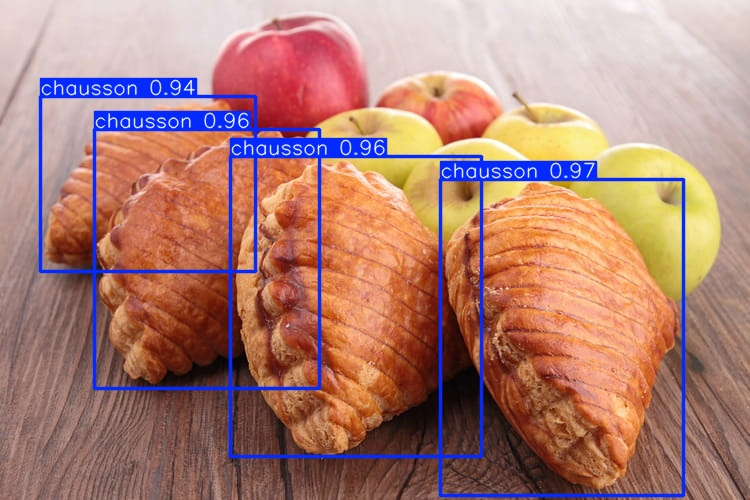
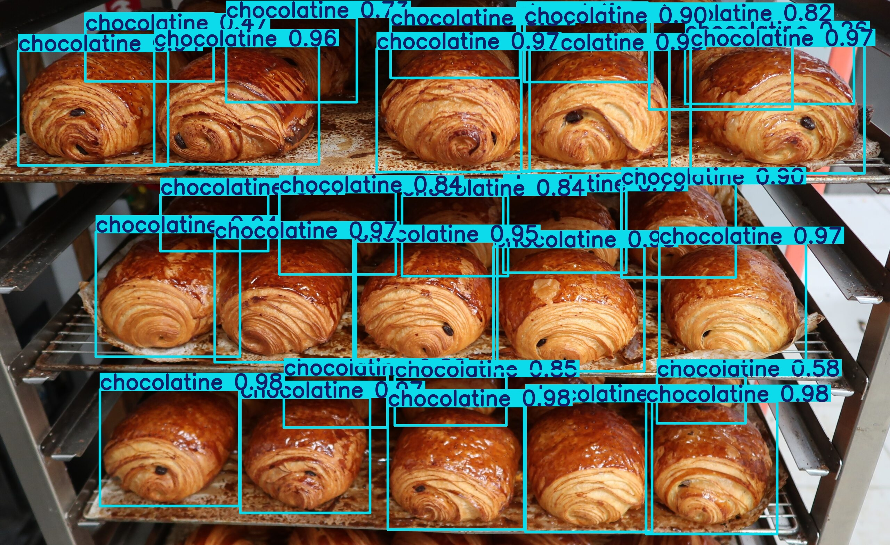
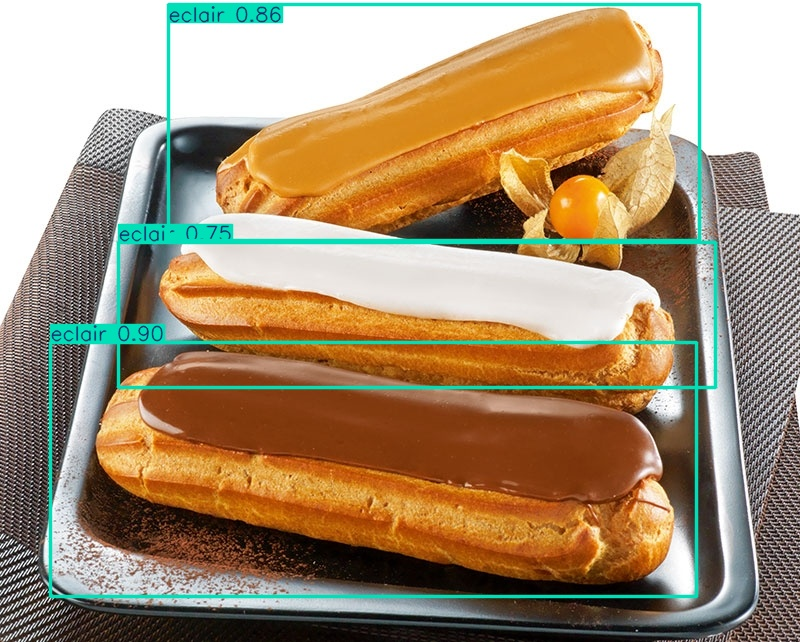
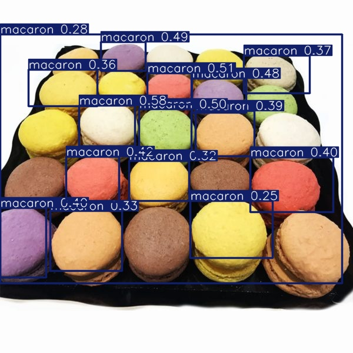
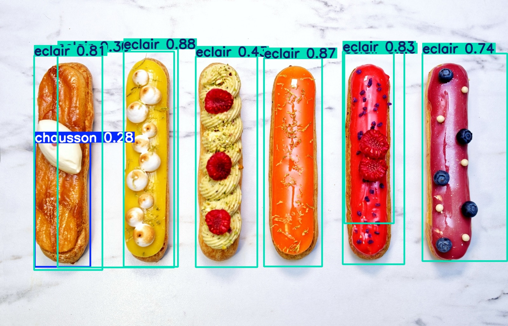
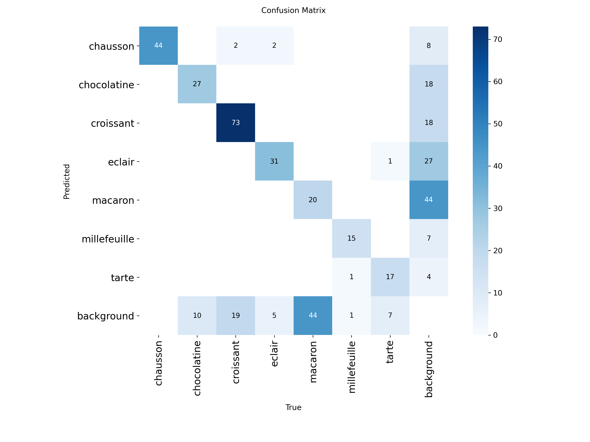

# French pastry detection with YOLOv8n

Object detection of 7 French pastries (chausson, chocolatine, croissant, éclair,
macaron, millefeuille, tarte) on a small hand-built dataset, with a fine-tuned
YOLOv8n. Course project (Deep Learning, ENSEEIHT, 2025-2026).

The interesting part isn't the model, it's the failure analysis: one class
(macaron) fails badly, and the cause turned out to be the labels, not the
detector.

**Team:** 3 students. I built the data pipeline (web scraping, cleaning,
split), trained and evaluated the model, did the error analysis and wrote the
reports. My teammates annotated the images.

## Data

- **780 images**: ~630 scraped from Bing Images (`icrawler`, 4 queries per
  class mixing product and context, e.g. "croissant boulangerie vitrine"),
  ~150 photos taken in Toulouse bakeries.
- Cleaning: corrupted files and images under 100×100 px removed, then a
  manual grid review to drop illustrations, logos and off-topic images
  (`scripts/cleaning.py`).
- Annotation: axis-aligned boxes in YOLO format, made with MakeSense.ai.
- Split 543 / 113 / 124 (train / val / test), stratified by the class of each
  image. No image appears in two splits.

**The dataset isn't in this repo.** Scraped images aren't mine to
redistribute, so only the collection and cleaning scripts are published, plus
a few example predictions (see [Examples](#examples)).
Per-image provenance (web vs. own photo) wasn't recorded, so I can't say
exactly how many of the 124 test images are our own bakery photos.

## Model and training

YOLOv8n pre-trained on COCO, fine-tuned for 50 epochs on a Colab T4
(~14 min), `imgsz=640`, `batch=16`, optimizer chosen automatically by
Ultralytics (AdamW). Augmentations are the Ultralytics defaults for
detection: mosaic (off for the last 10 epochs), HSV jitter, horizontal flip,
scale, plus light Albumentations (blur, grayscale, CLAHE, p = 0.01).
`best.pt` is the checkpoint selected by Ultralytics' default validation
fitness (0.1 · mAP50 + 0.9 · mAP50-95).

Training and evaluation code: `notebooks/train_eval.ipynb`.

## Results (test set, 124 images, 378 instances)

| Class | Precision | Recall | mAP50 | mAP50-95 |
|---|---|---|---|---|
| chausson | 0.870 | 0.842 | 0.901 | 0.705 |
| chocolatine | 0.752 | 0.800 | 0.854 | 0.632 |
| croissant | 0.548 | 0.807 | 0.757 | 0.500 |
| éclair | 0.739 | 0.579 | 0.579 | 0.277 |
| macaron | 0.350 | 0.176 | 0.271 | 0.109 |
| millefeuille | 0.773 | 0.944 | 0.949 | 0.527 |
| tarte | 0.910 | 0.877 | 0.902 | 0.416 |
| **all** | **0.706** | **0.718** | **0.745** | **0.452** |

These come from a **single training run** evaluated once on Colab and not
re-run since, so there's no variance estimate. With 124 test images and
15-20 images per class, per-class numbers can easily move by several points
from one run to the next. On validation, mAP50 still oscillates between 0.717
and 0.742 over the last 10 epochs.

Validation curves and confusion matrices are in `results/`.

## Examples

Test-set predictions at `conf=0.25`.

| | |
|---|---|
|  |  |
| Chaussons, several instances, confidence 0.92-0.95 | Dense bakery tray: about 30 chocolatines detected at once |
|  |  |
| Chocolate éclairs, confidence 0.78-0.87 | **Failure:** tray of 24 macarons, 15 found, all at low confidence (0.25-0.58), see [Error analysis](#error-analysis) |
|  | |
| **Failure:** low-confidence chausson box (0.28) on an éclair | |

*Example images collected from the web during the course project; original
sources were not tracked. If you own one of them and want it removed, open an
issue.*

<p align="center">
  
</p>

## Error analysis

**Errors are mostly misses, not class confusions.** On the validation
confusion matrix, cross-class mistakes are rare (a handful of chausson
predictions on croissants and éclairs, one millefeuille predicted as tarte).
Chocolatine and croissant, which I expected to be confused because they share
the same dough, are never swapped there: what fails is detection itself
(10 chocolatines and 19 croissants missed)

**Macaron: the labels were wrong, not the model.** Many macaron images show
trays or boxes of 10-20+ macarons, but only 1-2 of them were boxed. During
training, the detector is therefore penalised for finding the unlabelled ones
and learns to ignore macarons. The validation matrix shows both sides of it:

- 44 labelled macarons missed (69 %), almost never confused with another class;
- 44 macaron predictions with no matching label, many of them likely real
  macarons that were never annotated.

On a tray of 24 macarons the model finds 15, all with low confidence
(0.25-0.58), while an isolated macaron is detected at 0.82.

This has a consequence for evaluation: the test labels are probably
incomplete too, so the macaron numbers above are unreliable in both
directions. Real misses are undercounted, and some correct detections are
counted as false positives.

**A failed fix, and why it doesn't prove much.** We tried removing the 49
images with fewer than 3 macaron boxes. Macaron recall on validation dropped
from 0.25 to 0.074. That experiment was confounded: it also removed legitimate
single-macaron images (about 45 % of the class), it was a single run, and the
proper fix (relabel) wasn't tried. The only safe conclusion is that dropping
data didn't help. The right fix is an exhaustive relabel of macaron images,
including the test set, so that the measurement itself can be trusted.

**Other observed failures**
- Plain, unglazed éclairs sometimes get a low-confidence chausson box (golden,
  elongated).
- Millefeuilles seen from the side or in wide shots get much lower confidence
  than front views.
- Éclair has the lowest mAP50 after macaron (0.579): the class mixes classic
  chocolate éclairs and brightly glazed ones, with only 183 training
  instances.

## Limitations

- Single run, small test set, no confidence intervals.
- Class imbalance in instances (385 croissants vs 88 millefeuilles in train).
- Some scraped images are watermarked stock photos, a potential shortcut I
  didn't control for.
- Results not re-verified after the course.

## Usage

```bash
pip install ultralytics
yolo predict model=weights/best.pt source=path/to/image.jpg conf=0.25
```

Retraining requires the original dataset, which isn't redistributed (see
[Data](#data)).

## Repository layout

```
notebooks/   training + evaluation notebook (Colab)
scripts/     scraping.py, cleaning.py
weights/     best.pt
results/     results.csv, PR/F1 curves, confusion matrices (validation),
             label statistics (labels.jpg)
docs/figures example predictions
data.yaml    dataset config
```

## License

AGPL-3.0 (inherited from Ultralytics YOLOv8).